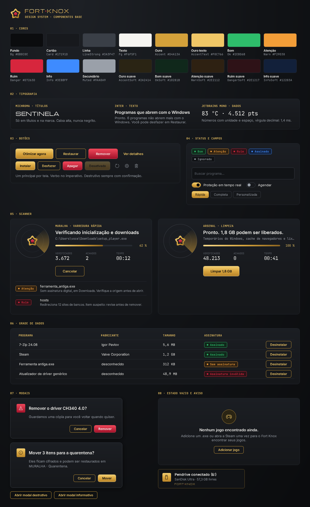

# Fort Knox · Design System e UI/UX (Fase 2)

Status: **proposta para aprovação**. Os componentes base já estão no código (`UI/`) e aparecem no catálogo vivo;
nenhuma tela existente foi trocada ainda (isso é a Fase 3).
Base: Brandbook v3 (Manifesto, Tom de voz, Naming, `fortknox-tokens.json`), `Theme.xaml` / `Brand.xaml` atuais e `docs/ARQUITETURA.md`.



Tema claro: [`design/catalogo-claro.png`](design/catalogo-claro.png).
Para ver ao vivo, com o scanner rodando e os modais abrindo: `FortKnox.exe --catalogo` (ou `--catalogo --claro`).

## 1. Princípios de interface

1. **Resultado primeiro.** Cada tela abre com o veredito (status + número) e só depois os detalhes.
2. **Um botão principal por tela.** Ouro = a ação que a pessoa veio fazer. O resto é contorno, texto ou ícone.
3. **Tudo tem volta, e a tela mostra isso.** Ação que muda o sistema mostra o que vai mudar antes e oferece **Restaurar** depois.
4. **Destrutivo nunca no Enter.** Vermelho, com confirmação, e o foco começa em **Cancelar**.
5. **Mesmas palavras em todo lugar.** Status só **Bom**, **Atenção**, **Ruim** (mais Info e Neutro para o que não é saúde).
6. **Calmo.** Nada de vermelho piscando nem "PERIGO". Animação curta e só onde informa (radar girando = trabalhando). Respeita "Efeitos de animação" do Windows.
7. **Dados em mono.** Números, caminhos e rótulos técnicos em JetBrains Mono, com unidade e espaço, vírgula decimal (83 °C, 1,4 ms, 4.512 pts).
8. **Claro e escuro iguais.** Toda cor vem de token com par claro/escuro; o ouro vira Bronze no claro para manter contraste.

## 2. Tokens

### 2.1 Cores

Fonte: `fortknox-tokens.json`. Pares escuro/claro em `ThemeManager.Palette`; valores iniciais em `Theme.xaml` e `UI/Tokens.xaml`.

| Token | Uso | Escuro | Claro |
|---|---|---|---|
| `Bg` / `WindowBg` | fundo da janela | `#0B0C0E` Preto Bunker | `#F6F5F1` Branco Lingote |
| `Card` / `CardFill` | cartões | `#17191D` | `#FFFFFF` |
| `Panel` | campos, faixas | `#111316` | `#EEEDE8` |
| `Line` / `LineStrong` | divisores, bordas | `#262A31` / `#3A3F47` | `#DCDAD3` / `#B9B6AD` |
| `Fg` / `Muted` / `Faint` | texto principal / secundário / dica | `#F6F5F1` / `#9AA0A9` / `#5E646D` | `#0B0C0E` / `#4A5058` / `#7D848E` |
| `Accent` / `AccentText` | Ouro Reserva / ouro para texto | `#D4A13A` / `#F0C766` | `#B8842A` / `#8C6A2A` Bronze |
| `AccentSoft` | fundo de destaque | `#2A2414` | `#F5EAD0` |
| `Ok` + `OkSoft` | **Bom** | `#2EBD6B` + `#10281B` | `#1E8F4F` + `#DDF3E6` |
| `Warn` + `WarnSoft` | **Atenção** | `#F29D38` + `#2E2112` | `#C77310` + `#FBEBD6` |
| `Danger` + `DangerSoft` | **Ruim**, destrutivo | `#D7263D` + `#2E1217` | `#B81F33` + `#F8DCE0` |
| `Info` + `InfoSoft` | Azul Sinal: informação, rede | `#3E8BFF` + `#12203A` | `#1F66D1` + `#DCE8FB` |
| `Scrim` | véu atrás de modal | 70 % preto | 50 % preto |

Novos nesta fase: `Info`, `InfoSoft`, `OkSoft`, `WarnSoft`, `DangerSoft`, `Scrim` (o Azul Sinal estava no Brandbook e faltava no app).
Degradês da marca (`GoldGradient`, `GoldButton`, `GoldMetal`, `RedGradient`) seguem em `Brand.xaml`.

### 2.2 Tipografia

| Papel | Fonte | Tamanho | Onde |
|---|---|---|---|
| Display (`H1`) | Michroma | 21 | título de página e marca. Caixa alta, nunca negrito |
| Título | Inter SemiBold | 16 | título de cartão, de modal |
| Corpo | Inter | 13 | texto geral |
| Legenda (`Sub`) | Inter | 12 | explicações, metadados |
| Rótulo (`Label`) | JetBrains Mono Bold | 10,5 | cabeçalho de seção e de tabela, em ouro |
| Dado (`Big`) | JetBrains Mono | 19 a 22 | números de destaque |

### 2.3 Espaço, raio e movimento

- **Grade de 4 px**: `Space1`…`Space8` = 4, 8, 12, 16, 20, 24, 32. Cartão com `CardPadding` 20, seções separadas por 24.
- **Raios**: controle 6 (`RadiusControl`), cartão 10 (`RadiusCard`), selo 4 (`RadiusBadge`).
- **Movimento**: 120 ms (hover) e 200 ms (entrada). O radar do scanner gira só durante a varredura e para quando o Windows está com animações desligadas.

## 3. Componentes base

Todos em `UI/`, namespace `FortKnox.UI`, estilos em `UI/Components.xaml`. Só apresentação: nenhum componente lê disco, registro ou rede.

| # | Componente | Tipo | Uso |
|---|---|---|---|
| 1 | **Botões** `PrimaryButton`, `OutlineButton`, `DangerButton`, `GhostButton`, `IconButton` + variantes `…Sm` | estilos | ação principal (ouro), secundária (contorno), destrutiva (vermelho), terciária (texto), ícone com ToolTip obrigatório |
| 2 | **`StatusBadge`** | controle | ponto + palavra nas cores de status; `Status="Atencao"` ou `Text` próprio ("Assinado") |
| 3 | **`DialogCard` / `FkDialog`** | controle + janela | substitui o `MessageBox`. `FkDialog.Confirm(owner, título, mensagem, "Remover", kind: DialogKind.Destructive)`; Esc cancela; destrutivo foca Cancelar |
| 4 | **`FkDataGrid`** | estilo | grade virtualizada (listas de milhares de arquivos/apps), cabeçalho mono ouro, linhas de 38 px, selo e botão por linha |
| 5 | **`ScannerPanel`** | controle | padrão único de varredura para MURALHA, Limpeza, Desinstalar e ALICERCE: radar com o Bastião, fase, item atual, progresso (ou indeterminado), contadores Verificados/Achados/Tempo, Iniciar/Cancelar e achados ao vivo com motivo |
| 6 | **`EmptyState`** | controle | ícone, frase do Tom de voz e uma ação ("Nenhum jogo encontrado ainda.") |
| 7 | **`FkProgress`** | estilo | barra fina ouro; indeterminada = lingote correndo |
| 8 | **ToolTip** | estilo implícito | dicas no tema, com quebra de linha |
| 9 | **`SectionHeader`** | estilo | "05 · SCANNER": rótulo mono ouro |
| — | Já existentes, mantidos | `CardBorder`, `Chip`, `CheckBox` (interruptor), `TextBox` (Tag = placeholder), `NavItem`, `TopTab`, `CardTemplate`, `ToastWindow` | |

### 3.1 Contrato do Scanner (o mais importante para a Fase 3)

O serviço do módulo varre; o ViewModel traduz o progresso em propriedades; o `ScannerPanel` só mostra.

```csharp
<ui:ScannerPanel Title="MURALHA · VARREDURA RÁPIDA"
                 State="{Binding State}"            // Idle | Running | Done | Cancelled | Error
                 Phase="{Binding Phase}"            // frase curta, Tom de voz: "Verificando downloads"
                 CurrentItem="{Binding Current}"    // caminho atual (mono, cortado com …)
                 Progress="{Binding Progress}"      // 0..1, ou NaN = indeterminado
                 ScannedCount="{Binding Scanned}" FindingsCount="{Binding Found}" Elapsed="{Binding Elapsed}"
                 Findings="{Binding Findings}"      // ScanFinding(Name, Detail, Status): Detail diz o MOTIVO
                 StartCommand="{Binding Start}" CancelCommand="{Binding Cancel}" StartText="Verificar agora"/>
```

Regras: atualizar no máximo ~10×/s (o serviço agrega); `Detail` sempre explica por que o item apareceu e o que fazer; ao terminar, `Phase` traz o resultado com número ("Pronto. 2 itens precisam da sua atenção.").

### 3.2 Padrões de tela (a aplicar na Fase 3)

```
┌ Página ──────────────────────────────────────────────────────────┐
│ MÓDULO · Página (H1)                       [ação secundária] [⟳] │
│ frase de contexto (Sub)                                          │
│ ┌ Veredito ───────────────────────────────────────────────────┐  │
│ │ StatusBadge  número grande  motivo   [Ação principal]       │  │
│ └─────────────────────────────────────────────────────────────┘  │
│ ┌ Scanner ou lista (FkDataGrid) ──────────────────────────────┐  │
│ └─────────────────────────────────────────────────────────────┘  │
│ Restaurar (Diário de Ferrolhos do módulo)                        │
└──────────────────────────────────────────────────────────────────┘
```

- **Carregando**: texto "Lendo sensores…" + `FkProgress` indeterminado; nunca tela em branco.
- **Vazio**: `EmptyState`. **Erro**: cartão com `StatusBadge` Ruim, o que houve, por quê e o que fazer (sem culpar a pessoa).
- **Responsivo** (janela de 960 a 2560 px): grades de cartões com `UniformGrid`/`WrapPanel` que passam de 3 para 2 e 1 colunas abaixo de 1280 e 1024 px; texto longo quebra, caminhos cortam com reticências; menu lateral recolhe para ícones abaixo de 1100 px (Fase 3).
- **Acessibilidade**: todo `IconButton` com `ToolTip` e `AutomationProperties.Name`; foco visível em ouro; contraste AA nos dois temas (por isso o ouro vira Bronze no claro); nada comunicado só por cor (o selo sempre tem a palavra).

## 4. Estrutura de pastas

Agora (Fase 2), dentro do projeto atual, já no namespace final:

```
UI/
├─ Tokens.xaml            ← cores de status, espaço, raio, tipo, movimento
├─ Components.xaml        ← estilos dos componentes base
├─ Controls/
│  ├─ HealthStatus.cs     ← HealthStatus, StatusBadge, EmptyState, RelayCommand
│  ├─ ScannerPanel.cs     ← ScannerPanel, ScanState, ScanFinding
│  └─ FkDialog.cs         ← DialogCard, FkDialog, DialogKind
└─ Catalog/
   └─ CatalogWindow.xaml(.cs) ← catálogo vivo (--catalogo, --png)
docs/design/              ← capturas do catálogo (claro e escuro)
```

Na Fase 3.1 (decisão D2 aprovada), a pasta vira projeto sem mudar namespace nem XAML:

```
src/FortKnox.UI/
├─ Themes/   Theme.xaml, Brand.xaml, Tokens.xaml, Components.xaml, ThemeManager.cs
├─ Controls/ StatusBadge, ScannerPanel, FkDialog, EmptyState, (próximos: RingGauge, MetricTile, PageHeader, VerdictCard)
├─ Assets/   Fonts/ (Michroma, Inter, JetBrains Mono, OFL), ícones
└─ Catalog/  CatalogWindow
```

## 5. Tecnologias recomendadas

| Escolha | Por quê |
|---|---|
| **WPF / .NET 8** (mantido) | todo o app já é WPF; DirectX/Vortice, ETW e WMI já integrados; single-file pronto. Trocar de UI agora (WinUI 3, Avalonia, web) custaria reescrever ~250 KB de XAML sem ganho para quem usa |
| **ResourceDictionary + DynamicResource** | troca claro/escuro na hora, já usada pelo `ThemeManager` |
| **Controles próprios leves** (sem biblioteca de UI de terceiros) | o visual é da marca, não de um kit (MahApps/MaterialDesign/HandyControl trariam outro estilo e mais peso) |
| **Segoe Fluent Icons** (do Windows) | ícones sem pacote extra; a folha de iconografia do Brandbook guia a escolha dos glifos |
| **MVVM leve** com `RelayCommand` próprio | sem dependência; `CommunityToolkit.Mvvm` (MIT) fica como opção se você aprovar na Fase 3 |
| **Catálogo vivo + PNG** | revisão visual a cada mudança; as capturas podem virar teste de regressão visual depois |

Nenhum código ou pacote de terceiros entrou nesta fase.

## 6. Próximo passo (Fase 3, depois da sua aprovação)

3.1 núcleo + projeto `FortKnox.UI` → 3.2 COFRE/PRENSA/RADAR → 3.3 demais módulos usando estes componentes → 3.4 Lastro e ARSENAL novo → 3.5 MURALHA com YARA (aprovado) → 3.6 Guarda.
